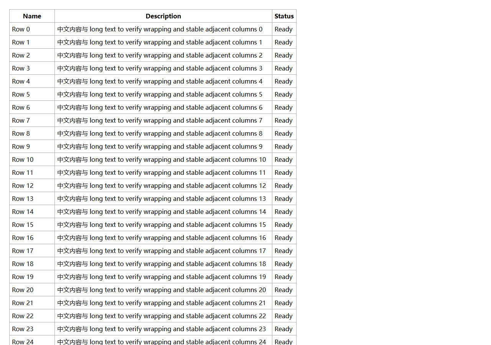

# Performance evidence / 性能验证

## Scope

Compared with upstream 1.1.0 at commit
`bb989d5d33bcc532981f4feaad43659bdefd995a`. The benchmark bundles both implementations
against the same small Obsidian API stub and runs them in the same Chromium
browser, with three columns of mixed Chinese/English wrapping text.

Each case sends **480 synthetic pointer moves in 60 animation frames** (8 moves
per frame), after initialization. There is one measured run per case, with
50, 300 or 1,000 body rows. This deliberately tests event bursts; a real browser
may already coalesce physical pointer events. It is not an Obsidian FPS test.

## Results

| Body rows | Upstream width-update calls | Fork width-update calls | Upstream cell-style mutations | Fork cell-style mutations | Fork total style mutations |
|---:|---:|---:|---:|---:|---:|
| 50 | 480 | 60 | 73,440 | 0 | 120 |
| 300 | 480 | 60 | 433,440 | 0 | 120 |
| 1,000 | 480 | 60 | 1,441,440 | 0 | 120 |

The deterministic improvement is the amount of submitted DOM work: one update
per frame and two element style writes per update, independent of row count.
These numbers do **not** imply that every upstream style write caused its own
synchronous layout, nor that the complete drag is faster by the mutation-count
ratio. Browsers batch rendering work.

Observed wall time for the same 60-frame workload in this single instrumented run:

| Body rows | Upstream elapsed | Fork elapsed |
|---:|---:|---:|
| 50 | 1,018.7 ms | 985.7 ms |
| 300 | 3,019.6 ms | 1,206.2 ms |
| 1,000 | 4,860.8 ms | 2,045.9 ms |

The small-table case is close to the display's frame-wait floor. Long-table layout
remains substantial: at 1,000 rows the CDP layout counter was 938.41 ms upstream
and 1,030.24 ms in the fork. The improvement here comes from reduced script/style
overhead; column-level updates do not make layout itself constant-time.

The exact browser version, run date, JavaScript timing, elapsed time, CDP layout
and style counters are recorded in [benchmark-results.json](benchmark-results.json).
Timing depends on hardware, browser, content and instrumentation; do not treat a
single run as a general speed multiplier. In particular, a geometry read right
after a frame can move rendering work into that read. `layoutFlushMs` alone is
not a fair comparison of total layout cost; use the full CDP counter deltas for
that distinction. MutationObserver instrumentation also adds overhead.

## What changed

Upstream: each pointer event enumerates every row and sets three properties on
each cell of the selected column. The fork: a pending width is consumed by the
next animation frame, which updates one `<col>` and the table width. Equal
widths are skipped. Pointer release flushes the final coordinate before saving.

Initial setup still reads header geometry and traverses cells once to remove
legacy width triplets. Geometry is read before writes. Saved-width restoration
waits for attached, visible sections rather than freezing zero measurements.
Resize observers are released on renderer-section unload, disable or plugin
unload. Continuous dragging performs no per-row style writes.

## Regression coverage

The Chromium suite covers frame coalescing on a 1,000-row table, native mouse
dragging, final release coordinates, persistence and restoration, legacy widths,
min/max limits, identical-width updates, multiple pointers, cancel, blur, lost
capture, disable, unload, detached/hidden sections, renderer lifecycle cleanup,
and an iframe representing a secondary document/window context. Separate
compatibility samples verify that the upstream table-ID algorithm is unchanged.

## Limits / 验证边界

本次验证使用真实 Chromium 浏览器、标准 DOM 和 Obsidian API 桩，没有修改或安装到
用户的真实知识库。尚未完成真实 Obsidian 中的主题、其他插件、触摸设备和独立窗口
手工验收；iframe 测试只验证跨文档的事件及清理逻辑。

列宽变化仍会引起文字换行、行高变化及表格布局。此分支减少的是重复 JavaScript 和
样式提交工作，不能消除浏览器渲染长表格的成本，也不保证 1,000 行表格始终达到 60 FPS。
首帧初始化与持续拖动的成本不同；本基准不评估整个 Obsidian 的启动或文件渲染耗时。

## Reproduce

```sh
npm ci
npx playwright install chromium
npm run build
npm test
node scripts/verify-table-id.js
npm run benchmark
npm run package
```

Use a full clone because the baseline and original-license check read the fork
point from Git history. On Windows installed Edge is used when available; set
`TCR_BROWSER_PATH` to choose a specific Chromium executable.


